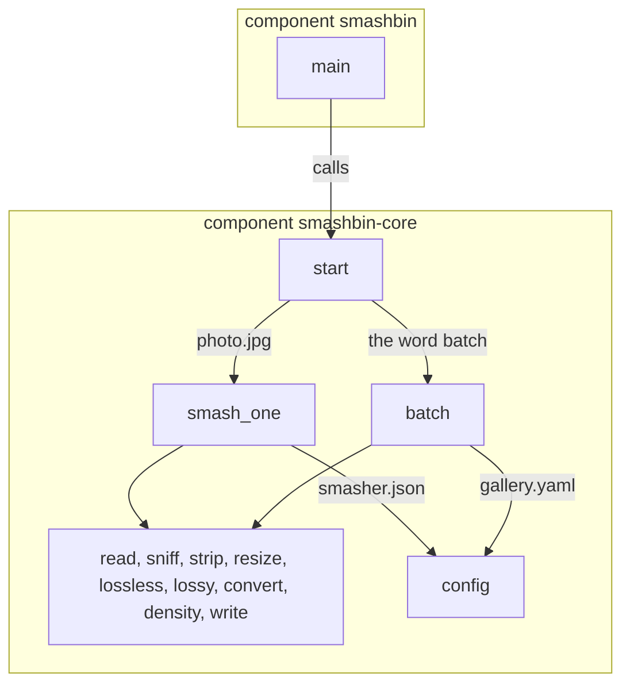
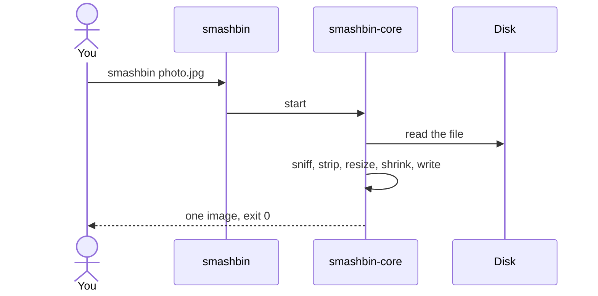
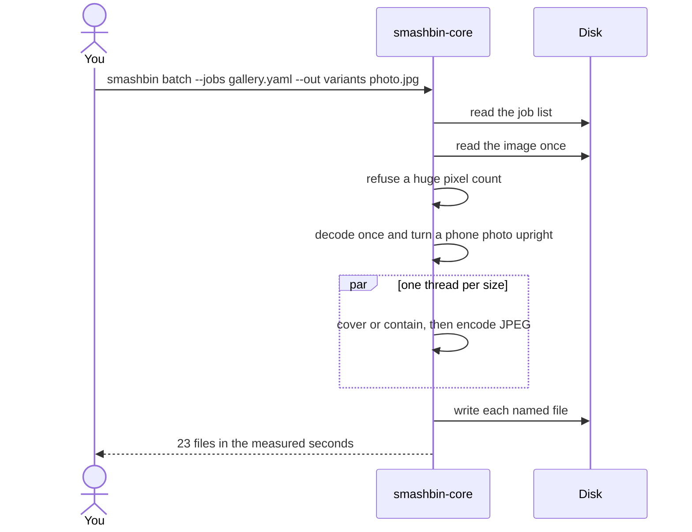

# Tutorial diagram

smashbin is two crates. The binary starts the library. The library has two doors. The ordinary door handles one job. The batch door decodes once and writes every size.

## Components

`main` is the only code in the `smashbin` binary. `start` is the only public function in `smashbin-core`. Everything else stays inside the library.

`smash_one` and `batch` both use the step files. They do not call each other. A `smasher.json` beside a photo reaches `config` through `smash_one`. `gallery.yaml` reaches `config` through `batch`.

## Ordinary command

One file goes through the steps once. A smasher file repeats that whole trip, including the read, once per job.

## Batch command

The job list is read first. The image is read once and decoded once. Each size is fitted from that picture, and the JPEGs are encoded together. stderr then prints the clock.

